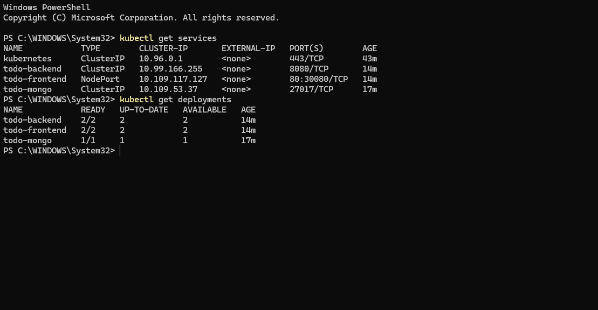
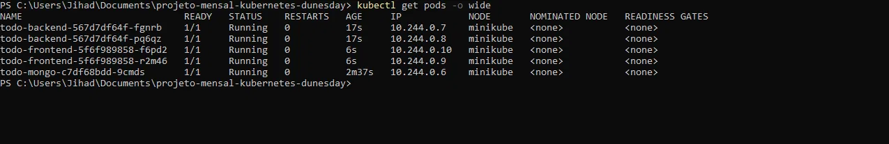
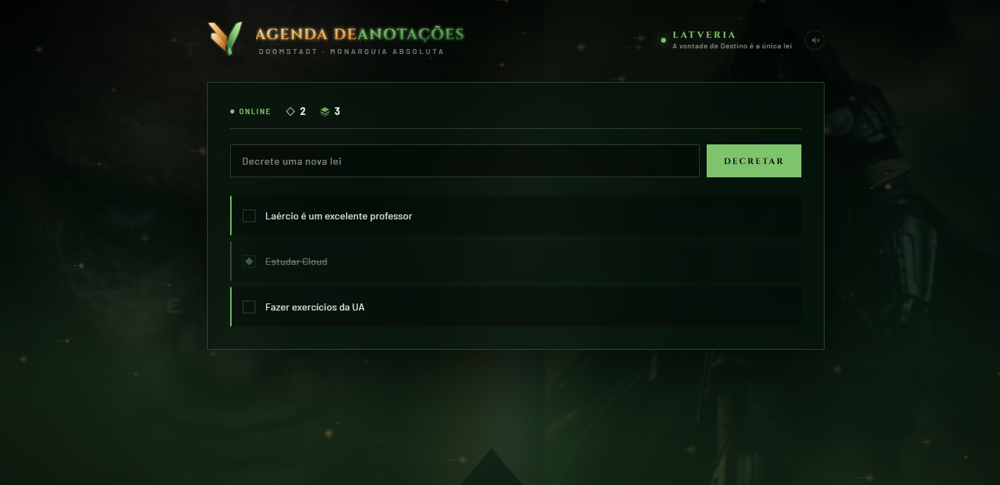
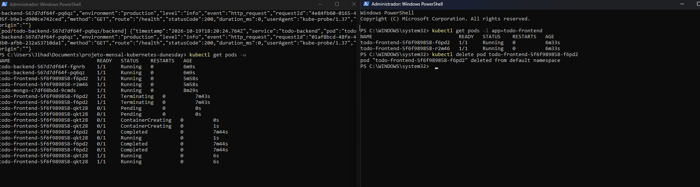
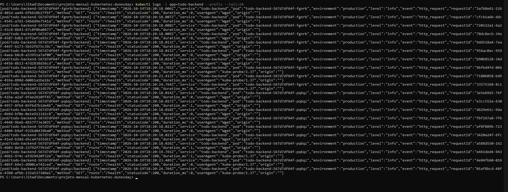
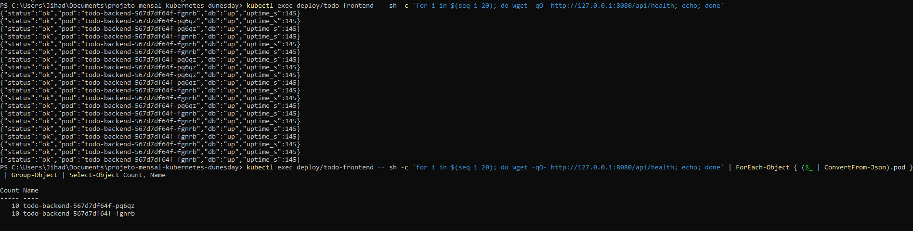

# DUNESDAY — Agenda de Anotacoes no Kubernetes

Aplicacao full-stack (React + Node.js + MongoDB) orquestrada com Kubernetes no Minikube.
Projeto academico da disciplina de Containers e Orquestracao — UniAmerica Descomplica.

## Arquitetura

```
┌─────────────────────────────────────────────────────┐
│                    Minikube Cluster                  │
│                                                     │
│  ┌──────────────┐  ┌──────────────┐  ┌───────────┐  │
│  │  Frontend x2  │──│  Backend x2   │──│ MongoDB x1│  │
│  │  (React/Nginx)│  │  (Node.js)    │  │  (PVC)    │  │
│  │  NodePort     │  │  ClusterIP    │  │ ClusterIP │  │
│  │  :30080       │  │  :8080        │  │ :27017    │  │
│  └──────────────┘  └──────────────┘  └───────────┘  │
└─────────────────────────────────────────────────────┘
```

| Componente | Replicas | Service     | Porta  |
|------------|----------|-------------|--------|
| Frontend   | 2        | NodePort    | 30080  |
| Backend    | 2        | ClusterIP   | 8080   |
| MongoDB    | 1        | ClusterIP   | 27017  |

## Pre-requisitos

- [Docker Desktop](https://www.docker.com/products/docker-desktop/) instalado e rodando
- [Minikube](https://minikube.sigs.k8s.io/docs/start/) instalado
- [kubectl](https://kubernetes.io/docs/tasks/tools/) instalado

## Passo a passo para rodar o projeto

### 1. Iniciar o Minikube

```bash
minikube start --driver=docker
```

Verificar se esta rodando:

```bash
minikube status
```

### 2. Apontar o Docker para o daemon do Minikube

As imagens precisam ser construidas **dentro** do Minikube, senao ele nao encontra.

**Linux / macOS:**

```bash
eval $(minikube docker-env)
```

**Windows PowerShell:**

```powershell
& minikube -p minikube docker-env --shell powershell | Invoke-Expression
```

> Esse comando so vale para o terminal atual. Se abrir outro terminal, rode de novo.

### 3. Construir as imagens Docker

No mesmo terminal do passo 2:

```bash
docker build -t todo-frontend:latest ./frontend
docker build -t todo-backend:latest ./backend
docker build -t todo-mongo:latest ./banco-de-dados
```

Conferir se as 3 imagens apareceram:

```bash
docker images | grep todo
```

### 4. Criar os recursos Kubernetes

Aplique os manifestos nesta ordem (banco primeiro, depois backend, por ultimo frontend):

```bash
# ConfigMap e Secret
kubectl apply -f k8s/mongo-secret.yaml
kubectl apply -f k8s/app-configmap.yaml

# Banco de dados
kubectl apply -f k8s/mongo-deployment.yaml
kubectl apply -f k8s/mongo-service.yaml

# Backend
kubectl apply -f k8s/backend-deployment.yaml
kubectl apply -f k8s/backend-service.yaml

# Frontend
kubectl apply -f k8s/frontend-deployment.yaml
kubectl apply -f k8s/frontend-service.yaml
```

### 5. Verificar se tudo subiu

```bash
kubectl get pods
kubectl get services
kubectl get deployments
```

Todos os Pods devem estar com STATUS `Running` e READY `1/1`.

### 6. Acessar a aplicacao

**Opcao A — minikube service:**

```bash
minikube service todo-frontend --url
```

Copie a URL exibida e abra no navegador.

**Opcao B — port-forward:**

```bash
kubectl port-forward service/todo-frontend 8081:80
```

Acesse `http://localhost:8081` no navegador.

> Ambos os tuneis ficam ativos apenas enquanto o terminal estiver aberto. O cluster continua rodando normalmente.

### 7. Parar e retomar

```bash
# Parar o cluster (preserva tudo)
minikube stop

# Retomar depois
minikube start

# Deletar o cluster por completo
minikube delete
```

## Comandos uteis

| Comando | O que faz |
|---------|-----------|
| `kubectl get pods` | Lista todos os Pods |
| `kubectl get pods -o wide` | Pods com IP e no |
| `kubectl get services` | Lista Services e portas |
| `kubectl get deployments` | Deployments e replicas |
| `kubectl logs -l app=todo-backend --prefix --tail=10` | Ultimos logs do backend |
| `kubectl describe pod <nome>` | Detalhes de um Pod |
| `kubectl delete pod <nome>` | Deleta um Pod (ReplicaSet recria) |
| `kubectl rollout restart deploy/todo-frontend` | Forca redeploy do frontend |

## Evidencias

### Services e Deployments ativos



Tres Services (todo-frontend NodePort:30080, todo-backend ClusterIP:8080, todo-mongo ClusterIP:27017) e tres Deployments com todas as replicas disponiveis.

### Pods com IP interno



Cinco Pods rodando no no `minikube`, cada um com seu IP interno na rede 10.244.0.x.

### Aplicacao em execucao



Frontend DUNESDAY acessado via tunel — a agenda de anotacoes com tema de Latveria funcionando no cluster.

### Self-healing: Pod deletado volta sozinho



Pod `todo-frontend` deletado manualmente. O ReplicaSet detectou e recriou um novo Pod em segundos, mantendo sempre 2 replicas ativas.

### Logs do Backend (health check)



Logs dos dois Pods backend recebendo requisicoes GET /health do kube-probe — prova de que o liveness/readiness esta configurado e funcionando.

### Balanceamento de carga entre replicas



20 requisicoes ao endpoint /api/health: 10 responderam do Pod `fgnrb` e 10 do Pod `pq6qz` — o Service distribui a carga igualmente entre as replicas do backend.

## Tecnologias

- **Frontend:** React 18 + Vite + Nginx
- **Backend:** Node.js + Express + Mongoose
- **Banco:** MongoDB 7 com PersistentVolumeClaim
- **Orquestracao:** Kubernetes (Minikube)
- **Containerizacao:** Docker + Docker Compose

## Equipe

- Heron Felipe
- Jihad Ghozayel
